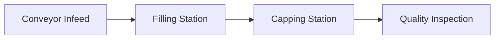

# LinePulse — Software-Simulated IIoT Fault Propagation

LinePulse is a MERN-oriented engineering micro-project that simulates a four-station industrial packaging line in software. It demonstrates virtual sensor telemetry, finite buffers, machine-state transitions, fault injection, event-based investigation and estimated production loss. No physical hardware or external IoT devices are required.

> **Data note:** All sensor readings and machine behavior are synthetic. This is a simplified teaching model, not a calibrated digital twin or production control system.

## Industrial problem

A fault at a downstream station can fill buffers, block upstream production and reduce accepted output. LinePulse models these dependencies instead of painting every machine red when a fault occurs.

## Architecture

- **Client:** React, Vite, Recharts and CSS design tokens.
- **Server:** Node.js, Express, Zod request validation and Socket.IO.
- **Simulation:** seeded pseudo-random variation, discrete ticks, finite station buffers, fault injection, telemetry and event recording.
- **Database:** MongoDB connection configuration is provided; the current simulation runtime is in-memory, so durable persistence is a known limitation.

See [architecture](docs/architecture.md), [simulation model](docs/simulation-model.md), [API reference](docs/api-reference.md), [demo scenarios](docs/demo-scenarios.md) and [limitations](docs/limitations.md).

## Requirements

- Node.js 20+
- npm 10+
- MongoDB is optional for the current in-memory demo.

## Run locally

1. Copy `server/.env.example` to `server/.env`.
2. Copy `client/.env.example` to `client/.env`.
3. From the repository root run `npm install`.
4. Run `npm run dev`.
5. Open http://localhost:5173; API health is at http://localhost:4000/api/health.

The simulation begins paused. Start the line or use Fault Lab to inject a fault. Scenario controls exercise the same server-side engine as manual fault controls.

## Commands

- `npm run dev` — start client and server.
- `npm run build` — build client assets.
- `npm test` — run simulation unit tests.
- `npm run lint` — run basic syntax checks and frontend lint.
- `npm run seed` — verify the configured MongoDB connection.

## Example API calls

```bash
curl http://localhost:4000/api/simulation/status
curl -X POST http://localhost:4000/api/simulation/start
curl -X POST http://localhost:4000/api/simulation/scenarios -H 'Content-Type: application/json' -d '{"name":"downstream-failure"}'
curl http://localhost:4000/api/reports/telemetry.csv -o telemetry.csv
```

## Production flow



## Screenshots

Add genuine screenshots of the running application here after launching it locally. No placeholder image is presented as a real capture.

## Known limitations and next work

The first implementation focuses on a runnable simulation and interactive overview. Durable Mongoose persistence for telemetry, incidents, simulation runs, operator actions and configuration, persistent run history, comprehensive API integration tests, report filters and complete OEE inputs need further implementation. See [known limitations](docs/limitations.md).

## License

MIT. See [LICENSE](LICENSE).
