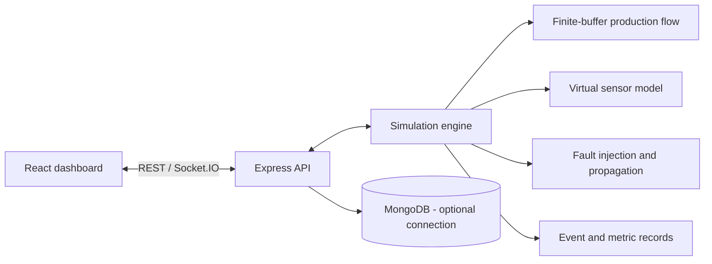

# Architecture

LinePulse is a modular-monolith teaching application. The React/Vite client reads the Express REST API and subscribes to Socket.IO. A single backend simulation engine is the authoritative owner of simulated clock, station states, finite buffers, faults, telemetry, events and metrics.

All telemetry is synthetic. The current baseline stores active demo state in memory; MongoDB connection is optional and durable model persistence is not yet wired into every route.
